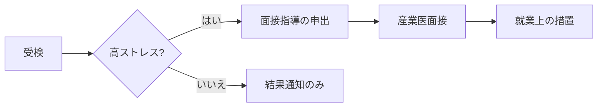
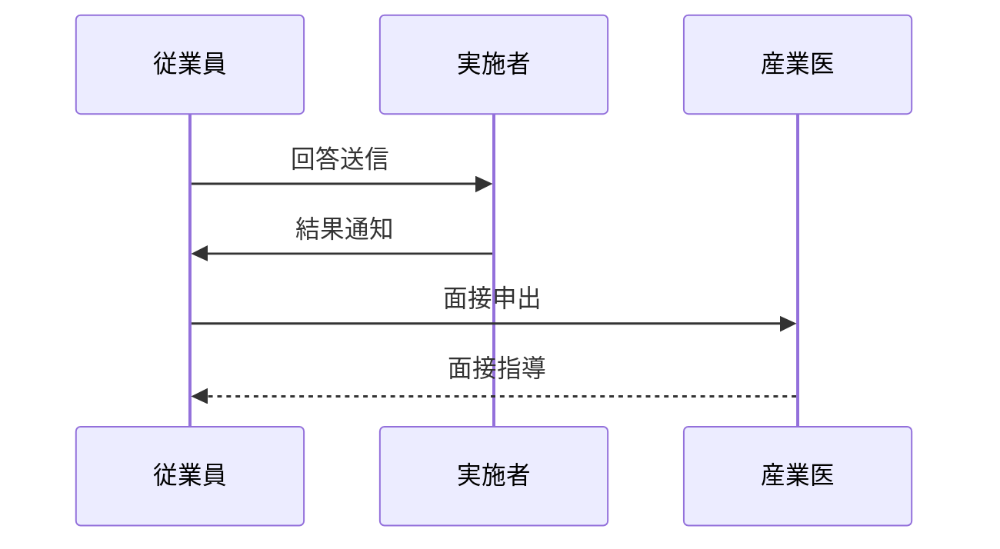

# MD Viewer 動作確認サンプル

このファイルを MD Viewer で開くと、対応している記法が一通り確認できます。
左の **目次** で見出しにジャンプ、`Ctrl+F` でページ内検索、`Ctrl+D` でダークテーマを試してください。

## 1. テキスト装飾

**太字**、*斜体*、~~取り消し線~~、`インラインコード`、[外部リンク (既定ブラウザで開く)](https://www.mhlw.go.jp/)、
自動リンク https://example.com/ 、脚注[^1]。

> 引用ブロック。
> 産業医面接指導の記録などは、こうした引用で原文を区別すると読みやすい。

[^1]: 脚注はページ末尾にまとまって表示されます。

## 2. リスト

1. 番号付きリスト
2. 二番目
   - 入れ子の箇条書き
   - もう一つ
3. 三番目

- [x] 完了したタスク
- [ ] 未完了のタスク

## 3. 表

| 区分 | 高ストレス者判定 | 面接指導 | 備考 |
|---|:---:|:---:|---|
| 合計点方式 | 77 点以上 | 要 | 29 項目合計 |
| 素点換算方式 | 領域 B 12 点以下 等 | 要 | 厚労省マニュアル準拠 |
| 集団分析 | — | — | 10 名以上の部署単位 |

長い表は横スクロールできます。

## 4. コードブロック

```python
def judge_high_stress(total: int) -> bool:
    """合計点方式 (簡易判定)"""
    return total >= 77
```

```sql
select org_id, count(*) as examinees
from check_results
where period_status = 'completed'
group by org_id;
```

```powershell
dotnet publish tools/md-viewer/MdViewer/MdViewer.csproj -c Release -o publish
```

## 5. mermaid 図





## 6. 画像

相対パスの画像は文書と同じフォルダを基準に表示されます (この例では画像ファイルが無いので代替テキストが出ます)。


## 7. 見出しの階層

### 7.1 第三レベル

#### 7.1.1 第四レベル

本文。

### 7.2 日本語の見出しもアンカーになります

[「2. リスト」へ戻る](#2-リスト)

---

以上。
